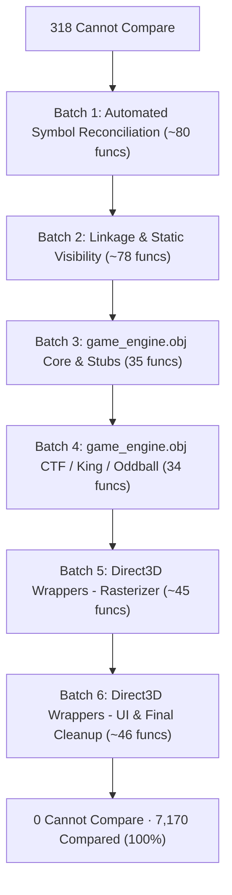

# Remediation Plan: 318 Cannot-Compare Functions (Target: 0)

This document outlines the systematic strategy, batch schedule, technical root causes, and ready-to-use master prompt for eliminating all 318 "cannot compare" functions on the Halo Combat Evolved decompilation dashboard ([nickarcade.github.io/halo](https://nickarcade.github.io/halo)).

---

## 1. Executive Summary & Objective

- **Current Status**: 318 cannot compare · 0 unchecked · 6,852 compared (94.67% ported).
- **Target Status**: **0 cannot compare** · **0 unchecked** · **7,170 compared** (100% of ported game functions audited).
- **Primary Execution Engine**: Google Colab session `msvc-halo` (Wine + MSVC 2003 `cl.exe` on x86_64 CPU).
- **Total Work Scope**: 6 Batches across 318 functions.
- **Estimated Total Time**: ~11 – 13 engineering hours across 3–4 focused sessions.

---

## 2. Technical Taxonomy of the 318 Functions

A function is classified as `cannot_compare` by [`tools/report/generate_decomp_report.py`](../tools/report/generate_decomp_report.py) when a structural audit was recorded, but its instructions could not be aligned into a byte-comparable span.

| Category | Count | Primary Cause | Typical Fix |
| :--- | :---: | :--- | :--- |
| **Symbol Name & Linkage Desyncs** | **~158** | Function was renamed in C code (e.g. `bipeds_initialize`), but `kb.json` still records the placeholder (`FUN_001a0780`), or function was declared `static` in C, preventing the compiler from exporting a global COFF symbol. | Reconcile symbol names between `kb.json` and `.c` source; remove unintended `static` qualifiers. |
| **Direct3D / XDK Inline Wrappers** | **~90** | DirectX 8 / Xbox XDK helpers (`D3DDevice_SetRenderState_*`, `D3DVertexBuffer_Unlock_*`, `D3DTexture_UnlockRect_*`) were inlined in C callers instead of being emitted as standalone out-of-line functions. | Provide standalone un-inlined wrapper definitions in platform compatibility units (e.g. `rasterizer_xbox_xdk_stubs.c`). |
| **`game_engine.obj` Missing Source** | **69** | `game_engine.obj` functions (`stub_engine_*`, `ctf_engine_*`, `slayer_engine_*`) are marked `ported: true` in `kb.json`, but `game_engine.obj` has `source_path: null`. No object file was built. | Associate `game_engine.obj` with its backing implementation files or compile a dedicated stub translation unit. |
| **Dummy Placeholder Stub** | **1** | `0x1454b0` (`placeholder_initialize`) in `<common>`. | Audit or resolve dummy placeholder entry in `kb.json`. |

---

## 3. Batch Schedule & Work Breakdown



### Batch Details

#### Batch 1: Automated Symbol Reconciliation (~80 functions)
- **Scope**: Reconcile naming desyncs between `kb.json` and `.c` source files where the symbol already exists in `build/vc71/*.obj`.
- **Primary Units**: `ai`, `bitmaps`, `objects`, `tags`, `sound_manager`, `bipeds`.
- **What's Involved**: Run automated COFF extraction script on Colab; detect 1-to-1 matches between `FUN_` addresses and implemented C function symbols; update `kb.json` declarations and re-audit.
- **Estimated Time**: ~1.5 – 2.0 hours.

#### Batch 2: Linkage & `static` Visibility (~78 functions)
- **Scope**: Functions implemented in source files but missing from COFF symbol tables due to `static` internal linkage or differing signatures.
- **Primary Units**: `objects`, `tags`, `ui_widget`, `director`, `rasterizer_text`, `cache_files_windows`.
- **What's Involved**: Remove `static` keyword so MSVC exports the symbol; align parameter types with `kb.json`; recompile and verify COFF symbols via `raw_xbe_structural.py`.
- **Estimated Time**: ~2.0 – 2.5 hours.

#### Batch 3: `game_engine.obj` (Part 1: Core, Slayer & Race — 35 functions)
- **Scope**: Multiplayer game engine core stubs and initial game modes.
- **Functions**: `initialize_player_multiplayer_data`, `game_engine_game_ending`, `slayer_engine_*`, `race_engine_*`, `stub_engine_*`.
- **What's Involved**: Map source file in `kb.json` or create dedicated `src/halo/game/game_engine_stubs.c`; compile on Colab and verify.
- **Estimated Time**: ~2.0 hours.

#### Batch 4: `game_engine.obj` (Part 2: CTF, King of the Hill & Oddball — 34 functions)
- **Scope**: Objective game modes and multiplayer statistics handlers.
- **Functions**: `ctf_engine_*`, `king_engine_*`, `oddball_engine_*`, scoring and warning callbacks.
- **What's Involved**: Hook up or export remaining game mode callbacks; verify COFF symbol emission and run structural audits.
- **Estimated Time**: ~2.0 hours.

#### Batch 5: Direct3D XDK Inline Wrappers (Rasterizer TUs — ~45 functions)
- **Scope**: Non-inlined DirectX 8 / XDK wrapper functions called by the 3D rendering pipeline.
- **Primary Units**: `rasterizer_xbox_hardware_bitmaps`, `rasterizer_xbox_draw_primitives`, `rasterizer_xbox_dynavobgeom`, `rasterizer_xbox_environment_fog`.
- **What's Involved**: Implement explicit out-of-line wrapper functions matching XDK symbols (e.g., `D3DDevice_SetRenderState_9`, `D3DTexture_UnlockRect_0`); recompile and audit.
- **Estimated Time**: ~2.0 – 2.5 hours.

#### Batch 6: Direct3D XDK Wrappers (UI & Progress Bar) & Final Cleanup (~46 functions)
- **Scope**: Remaining Direct3D helpers in 2D UI units plus final metadata reconciliation.
- **Primary Units**: `player_ui`, `progress_bar`, `ui_widget`, plus `0x1454b0` (`placeholder_initialize`).
- **What's Involved**: Emit UI Direct3D wrapper symbols; resolve `placeholder_initialize`; re-run `generate_decomp_report.py` to achieve **0 cannot compare**.
- **Estimated Time**: ~1.5 – 2.0 hours.

---

## 4. Environment & Execution Guidelines

1. **Remote Colab Execution**:
   - All Wine, MSVC 2003 (`cl.exe`), `vc71_verify.py`, `raw_xbe_structural.py`, and report generation must be executed remotely on `msvc-halo`:
     ```bash
     rtk colab --auth=oauth2 exec -s msvc-halo --timeout 120 -f <script.py>
     ```
   - **Do NOT switch Colab to GPU**: The entire build pipeline is CPU-bound x86 C compilation; GPU compute units will be wasted.
2. **Command Formatting & Git Authorship**:
   - Prefix every shell command with `rtk` (e.g., `rtk git status`).
   - Author all git commits as: `nickarcade <kabalabc@gmail.com>`.
   - Never read `kb.json` directly (`rtk jq` only).
   - Use modern CLI tools (`rg`, `bat --paging=never`, `eza`, `choose`, `sd`).
   - Run hazard scans before committing: `rtk python3 tools/audit/check_lift_hazards.py --changed-only`.
3. **Mandatory Binary Inspection & Search Tooling (`tools/extract_fn.py`)**:
   - For searching, querying, and analyzing any function, symbol, or address in the binary, **always query `python3 tools/extract_fn.py <0xaddr_or_symbol>`** for decompiled C, or add `--asm` for assembly and stack layout.
   - Never view, read, hexdump, or disassemble `halo-patched/cachebeta.xbe` directly.
   - Use `extract_fn.py` to confirm authentic function bodies, string references, callee context, and parameter signatures whenever diagnosing symbol name desyncs or inlined stubs.

---

## 5. Master Prompt (Copy & Paste Into New Conversation)

````markdown
We are resolving the remaining "318 cannot compare" functions in the Halo Combat Evolved (Xbox debug build 2276) decompilation repository so that `cannot_compare_functions` reaches 0 on the dashboard (nickarcade.github.io/halo).

### Environment & Execution Doctrine
1. Remote Colab Engine (`msvc-halo`):
   - All Wine, MSVC 2003 (cl.exe), `vc71_verify.py`, `raw_xbe_structural.py`, and report generation MUST be executed on Google Colab via:
     `rtk colab --auth=oauth2 exec -s msvc-halo --timeout 120 -f <script.py>`
   - To prevent local mobile CPU throttling and thermal strain, do NOT run Wine or heavy compilation on the local Android/Termux device.
   - Colab is on an x86_64 CPU runtime (do not switch to GPU; MSVC/Wine is CPU-bound).
2. Command & Git Rules:
   - Prefix every shell command with `rtk` (including chained commands).
   - Author all git commits as: `nickarcade <kabalabc@gmail.com>`.
   - Never read `kb.json` directly (`rtk jq` only).
   - Use modern CLI tools (`rg`, `bat --paging=never`, `eza`, `choose`, `sd`).
3. Binary Search & Function Inspection (`tools/extract_fn.py`):
   - **Never inspect, view, read, or disassemble `cachebeta.xbe` directly.**
   - **Mandatory Query Tool**: Always use `python3 tools/extract_fn.py <0xaddr_or_symbol>` for decompiled C, or add `--asm` for disassembly and stack frame layout. Use this tool for all function searching and signature verification as needed.

### Why Functions Are "Cannot Compare"
A function is classified as `cannot_compare` by `generate_decomp_report.py` when it has a structural audit record but cannot be compared byte-for-byte. In our repo:
- 317 functions fail with: `candidate has 0 COFF function symbols for <name>` because:
  a) Symbol name desync between `kb.json` and the C function in `src/`.
  b) Function is marked `static` in C, preventing the compiler from exporting a global COFF symbol.
  c) `game_engine.obj` currently has `source_path: null` in `kb.json`, so no object is compiled for it.
  d) DirectX / XDK inline helpers (`D3DDevice_SetRenderState_*`, `D3DVertexBuffer_Unlock_*`) were inlined by the compiler rather than emitted as standalone functions.
- 1 function (`0x1454b0`, `placeholder_initialize`) has no source path.

### Execution Workflow Per Batch
For each batch:
1. Identify the batch's target functions and their parent translation units.
2. Query `python3 tools/extract_fn.py <0xaddr_or_symbol>` as needed to inspect authentic binary logic, string anchors, and signatures.
3. Run a diagnostic script on Colab dumping the COFF symbols of the compiled `.obj` (`tools/verify/raw_xbe_structural.py` or `objdump`/`dumpbin`).
4. Apply the appropriate fix:
   - If name mismatch: update `kb.json` or `.c` definition to match the authentic symbol name.
   - If `static` linkage: remove `static` to export the symbol in the `.obj`.
   - If `game_engine.obj`: map the source file or compile the stub unit.
   - If D3D wrapper: ensure the out-of-line wrapper function is emitted.
5. Verify with `raw_xbe_structural.py` on Colab that the symbol is found and scores `structural exact` or `structural differ`.
6. Run hazard review: `rtk python3 tools/audit/check_lift_hazards.py --changed-only`.
7. Commit changes atomically and push to `origin/mainrevised2`.
8. Sync the Colab working tree with `git pull origin mainrevised2`.

### Batch Roadmap
- Batch 1: Automated Symbol Reconciliation (~80 functions with name desyncs across `ai`, `bitmaps`, `objects`, `tags`).
- Batch 2: Linkage & `static` Visibility (~78 functions across `objects`, `tags`, `ui_widget`, `rasterizer_*`, `director`).
- Batch 3: `game_engine.obj` Phase 1 (35 core, slayer, and race engine stubs).
- Batch 4: `game_engine.obj` Phase 2 (34 CTF, king of the hill, and oddball engine stubs).
- Batch 5: Direct3D XDK Wrappers Phase 1 (~45 rasterizer & hardware geometry/bitmap wrappers).
- Batch 6: Direct3D XDK Wrappers Phase 2 & Final Cleanup (~46 UI wrappers, placeholder_initialize, and report regeneration to reach 0 cannot compare).

Please start with Batch 1: run the diagnostic symbol comparison on Colab, report the identified name mismatches, and apply the Batch 1 fixes.
````
