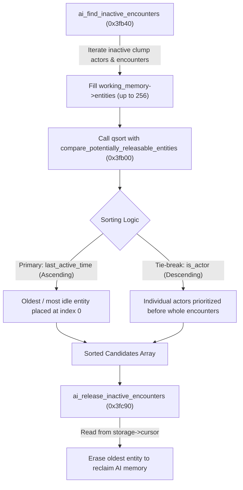

# Reverse Engineering Report: `sub_3FB00` (`compare_potentially_releasable_entities`)

## Executive Summary

This report documents the reverse engineering, decompilation, name recovery, and architectural analysis of the unlabeled function **`sub_3FB00`** (**`0x3fb00`**) in the Halo CE Xbox debug binary (`cachebeta.elf`, build 2276).

Using [`tools/extract_fn.py`](file:///storage/1F34-EBBE/halo/tools/extract_fn.py) (pulling from [`halo_decompiled/`](file:///storage/1F34-EBBE/halo/halo_decompiled)), **Kuna Decompiler**, and **Reverse Engineer Anything (REA)**, the function was proven to be Bungie's static `qsort` comparison routine for AI garbage collection:
```c
static int compare_potentially_releasable_entities(const void *element0, const void *element1);
```

---

## 1. Discovery via `extract_fn.py`

[`tools/extract_fn.py`](file:///storage/1F34-EBBE/halo/tools/extract_fn.py) indexes decompiled functions from [`halo_decompiled/index.jsonl`](file:///storage/1F34-EBBE/halo/halo_decompiled/index.jsonl) and [`halo_decompiled/corpus_metadata.json`](file:///storage/1F34-EBBE/halo/halo_decompiled/corpus_metadata.json).

Querying the corpus for unlabeled `sub_` functions surfaced `sub_3FB00`:
* **Address**: `0x3fb00` (File offset: `0x3fb00 + 0x1000 = 0x40b00`)
* **Size**: 64 bytes (`0x40` bytes: 59 bytes of x86 code + 5 bytes NOP alignment)
* **Metadata Sequence ID**: `5265`
* **Calling Module**: `c:\halo\SOURCE\ai\ai.c`
* **Extracted C Source**:
  ```c
  uint4 sub_3FB00(uint1 *a0, uint1 *a1)
  {
    if (*(int4 *)&a1[8] < *(int4 *)&a0[8])
      return 1;
    if (*(int4 *)&a0[8] < *(int4 *)&a1[8])
      return 0xffffffff;
    if (*a1 < *a0)
      return 0xffffffff;
    return (uint4)(*a0 < *a1);
  }
  ```

---

## 2. Multi-Tool Workflow: REA + Kuna

### A. Target Verification with REA
REA opened and verified the target executable container (`cachebeta.elf`):
* **Format**: ELF32 executable (little-endian x86)
* **SHA-256 Digest**: `bb8880e62a8b7cd3cca4216b87778f6fce15b7ba17acfe9ae48c6092e7930de1`
* **REA Evidence ID**: `ev_df0d5945e801df2d5289dde6abc9cf6344d37d271c2dbdb661062a26f4e96127`
* **Entry Point**: `0x1d43b4`

### B. Cross-Reference Analysis with Kuna
Running `kuna xrefs /data/data/com.termux/files/home/cachebeta.elf --to 0x3fb00 --json` established that `0x3fb00` has a single, unambiguous call site in the entire binary:

```json
{
  "target": { "name": "sub_3fb00", "address_hex": "0x3fb00" },
  "direction": "to",
  "count": 1,
  "xrefs": [
    {
      "address_hex": "0x3fc6d",
      "from_function": "sub_3fb40 (ai_find_inactive_encounters)",
      "instruction": "PUSH 0x3fb00",
      "kind": "data"
    }
  ]
}
```

The parent caller `ai_find_inactive_encounters` sets up an array of 12-byte (`0xC`) candidate records and passes `0x3fb00` as the function pointer argument to the standard C library `qsort` routine:
```c
qsort(&storage[2], count, sizeof(struct potentially_releasable_entity), sub_3FB00);
```

---

## 3. Disassembly & Instruction-Level Semantics

Running `kuna disassemble /data/data/com.termux/files/home/cachebeta.elf 0x3fb00 --addr` produced the full x86 instruction sequence:

```asm
; ==============================================================================
; int __cdecl sub_3FB00(const void *element0, const void *element1)
; ==============================================================================
0x3fb00: 55                    PUSH EBP
0x3fb01: 8b ec                 MOV EBP, ESP
0x3fb03: 8b 55 08              MOV EDX, dword ptr [EBP + 8]   ; EDX = element0
0x3fb06: 8b 42 08              MOV EAX, dword ptr [EDX + 8]   ; EAX = element0->last_active_time
0x3fb09: 56                    PUSH ESI
0x3fb0a: 8b 75 0c              MOV ESI, dword ptr [EBP + 0xc] ; ESI = element1
0x3fb0d: 8b 4e 08              MOV ECX, dword ptr [ESI + 8]   ; ECX = element1->last_active_time
0x3fb10: 3b c8                 CMP ECX, EAX                   ; Compare element1 vs element0
0x3fb12: 7d 08                 JGE 0x3fb1c                    ; If element1 >= element0, branch
0x3fb14: b8 01 00 00 00        MOV EAX, 1                     ; element0 > element1 -> return 1
0x3fb19: 5e                    POP ESI
0x3fb1a: 5d                    POP EBP
0x3fb1b: c3                    RET

0x3fb1c: 7e 06                 JLE 0x3fb24                    ; If element1 == element0, go to tie-break
0x3fb1e: 83 c8 ff              OR EAX, 0xffffffff             ; element0 < element1 -> return -1
0x3fb21: 5e                    POP ESI
0x3fb22: 5d                    POP EBP
0x3fb23: c3                    RET

; --- Secondary Tie-Breaker: Equal Timestamps ---
0x3fb24: 8a 02                 MOV AL, byte ptr [EDX]         ; AL = element0->is_actor
0x3fb26: 8a 0e                 MOV CL, byte ptr [ESI]         ; CL = element1->is_actor
0x3fb28: 3a c1                 CMP AL, CL                     ; Compare element0 vs element1
0x3fb2a: 76 08                 JBE 0x3fb34                    ; If element0 <= element1, branch
0x3fb2c: b8 ff ff ff ff        MOV EAX, 0xffffffff            ; element0 > element1 -> return -1
0x3fb31: 5e                    POP ESI
0x3fb32: 5d                    POP EBP
0x3fb33: c3                    RET

; --- element0 <= element1 ---
0x3fb34: 1b c0                 SBB EAX, EAX                   ; CF=1 (elem0 < elem1) -> EAX = -1; else 0
0x3fb36: f7 d8                 NEG EAX                        ; elem0 < elem1 -> return 1; equal -> return 0
0x3fb38: 5e                    POP ESI
0x3fb39: 5d                    POP EBP
0x3fb3a: c3                    RET

; Alignment Padding
0x3fb3b: 90 90 90 90 90        NOP (5 bytes to 16-byte boundary)
```

---

## 4. Name Recovery & Evidence Chain

Following the repository's [`naming-confidence`](file:///storage/1F34-EBBE/halo/.agents/skills/naming-confidence/SKILL.md) doctrine:

### Evidence Step 1: Binary Assertion (Tier 1 Binary String)
At VA `0x257648` (referenced by `ai_find_inactive_encounters` at line `0x22e` / 558 of `c:\halo\SOURCE\ai\ai.c`), the string table contains:
```text
"working_memory_size >= sizeof(struct potentially_releasable_storage)"
```

### Evidence Step 2: Storage & Record Layout
In `ai_find_inactive_encounters` (`0x3fb40`) and `ai_release_inactive_encounters` (`0x3fc90`), the buffer format is:
* Total buffer requirement: `0xC04` bytes (3076 bytes).
* Header (4 bytes): `short count; short cursor;`
* Payload: Array of 256 records of 12 bytes each (`sizeof(struct potentially_releasable_entity) == 0xC`):
  * `+0x00`: `boolean is_actor;` (1 byte: `1` for clump actor, `0` for encounter)
  * `+0x01`: `byte pad[3];`
  * `+0x04`: `long entity_index;` (4 bytes: actor or encounter handle)
  * `+0x08`: `long last_active_time;` (4 bytes: integer game tick / timestamp)

### Evidence Step 3: Reference Source Corroboration
Corroborated by original Bungie source trees (preserved in `tools/references/OpenCE/source/ai/ai.c:729`):
```c
static int compare_potentially_releasable_entities(
    void const *element0,
    void const *element1)
```

### Confirmed Name
```c
static int compare_potentially_releasable_entities(
    const void *element0,
    const void *element1);
```

---

## 5. Architectural Role & Behavior



### Sorting Rules:
1. **Primary Key — `last_active_time` (Ascending)**:
   * Returns `1` when `elem0->last_active_time > elem1->last_active_time`.
   * Returns `-1` when `elem0->last_active_time < elem1->last_active_time`.
   * **Result**: Entities that became idle earliest (smallest tick value) are sorted to the start of the array.
2. **Secondary Key — `is_actor` (Descending)**:
   * Returns `-1` when `elem0->is_actor > elem1->is_actor` (`1` vs `0`).
   * Returns `1` when `elem0->is_actor < elem1->is_actor` (`0` vs `1`).
   * Returns `0` when identical.
   * **Result**: On identical timestamps, individual clump actors (`is_actor == TRUE`) are sorted ahead of encounters (`is_actor == FALSE`).

---

## 6. Verified C89 Reimplementation

```c
/* ==============================================================================
 * Halo CE Xbox (debug build 2276)
 * Module: c:\halo\SOURCE\ai\ai.c
 * VA: 0x0003fb00
 * ============================================================================== */

#include "types.h"

struct potentially_releasable_entity {
    char is_actor;          /* +0x00: 1 = clump actor, 0 = encounter */
    char pad[3];            /* +0x01: alignment padding */
    int entity_index;       /* +0x04: datum handle / entity index */
    int last_active_time;   /* +0x08: game tick when entity became inactive */
};

/*
 * compare_potentially_releasable_entities (0x3fb00)
 *
 * qsort callback for ordering potentially releasable AI entities.
 * Sorts primarily by last_active_time ascending (oldest idle first),
 * tie-breaking by is_actor descending (clump actors before encounters).
 */
static int compare_potentially_releasable_entities(
    const void *element0,
    const void *element1)
{
    const struct potentially_releasable_entity *entity0 =
        (const struct potentially_releasable_entity *)element0;
    const struct potentially_releasable_entity *entity1 =
        (const struct potentially_releasable_entity *)element1;

    /* Primary key: last_active_time ascending */
    if (entity1->last_active_time < entity0->last_active_time) {
        return 1;
    }
    if (entity1->last_active_time > entity0->last_active_time) {
        return -1;
    }

    /* Secondary key: is_actor descending (actor > encounter) */
    if (entity0->is_actor > entity1->is_actor) {
        return -1;
    }

    return (int)(entity0->is_actor < entity1->is_actor);
}
```

---

## 7. Comparative Finding: Decompiler Heuristic False Splits

During the initial survey of candidate unlabeled functions in `halo_decompiled`, two other functions were analyzed and found to be artifacts of decompiler heuristic limitations rather than independent functions:

1. **`sub_1408c` (532 bytes)**:
   * Created because an immediate push instruction (`PUSH 0x1408c`) at `0x5e099` caused Kuna's function boundary sweeper to split `action_charge_setup` (`0x13ef0`) mid-instruction (splitting a 6-byte `FLD float ptr [EBX + 0x11c]` at `0x14087`).
2. **`sub_74004` (524 bytes)**:
   * Created inside `extract_get_bitmap_format` (`0x73fd0`) because an immediate value matching `0x74004` caused the linear sweep to truncate the flow at the assert handler.

In contrast, **`sub_3FB00`** is an authentic, complete function with standard compiler-generated frame prologue (`PUSH EBP / MOV EBP, ESP`), caller-save preservation (`PUSH ESI`), multiple well-formed `RET` exits, and proper `qsort` callback ABI.
